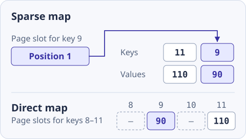

# Choosing a Container

Measured ratios for several containers are in [Benchmarks](benchmarks.md).
They come from one machine and serve as a reference.

| Need | Use | Instead of | Avoid when |
|---|---|---|---|
| Membership in dense integer ranges, ordered queries or range updates | [`PagedBitSet`](bit-set.md) | `PagedSparseSet` | keys are thinly scattered or you need a contiguous key array |
| Integer keys in runs or ranges; fast iteration and misses | `PagedSparseSet`, `PagedSparseMap` | `HashSet`, `HashMap`, `BTreeMap` | keys are spread uniformly over a wide range |
| Key-ordered iteration, range and nearest-key queries over dense ranges | `PagedDirectMap` | `BTreeMap` | keys are sparse inside their pages (iteration scans whole pages) |
| Entries as contiguous slices or arrays | `PagedSparseMap` (`key_slice`, `value_slice`; Python views) | `HashMap` | |
| Priority changes or removal by key | `PagedPriorityQueue` | `priority-queue` crate | priorities never change: `BinaryHeap` is faster |
| References that survive growth | `PagedVec`, `PagedDeque` | `Vec`, `VecDeque` | random access dominates and addresses need not be stable |
| Handles that detect removal (stale ids) | `Hive`, or `IdAllocator` with a paged map | `slotmap` | raw lookup speed matters more than stable addresses |
| Shared insertion from many threads | [concurrent containers](concurrent.md) | a `Mutex` around a plain container | a single thread mutates: the plain types are faster |

## Sparse Map or Direct Map

<figure class="pc-figure">
  
  <figcaption>With the same keys and values, a sparse map iterates the dense arrays. A direct map visits slots in ascending key order for integer keys.</figcaption>
</figure>

| | `PagedSparseMap` | `PagedDirectMap` |
|---|---|---|
| Where values live | dense array, parallel to the keys | in the page slot |
| Lookup | page lookup, slot read, dense read | page lookup, slot read |
| Iteration | dense array only, insertion order (changed by swap removal) | every allocated slot, key order |
| `clear` | O(1) for the index | scans allocated pages |
| Memory per allocated page | `PAGE` × 4 bytes | `PAGE` × slot size |
| Range queries | no (sort the dense array, then binary search) | `range`, `next_occupant`, `prev_occupant` |

Prefer the direct map when keys fill a few dense ranges, when you want key
order, or when lookups dominate. Prefer the sparse map when keys are scattered
thinly or when you need contiguous slices.

## Hive or `IdAllocator` with a Map

`Hive<T>` owns the elements; a removed element's id goes stale. An
`IdAllocator` owns only the ids; values live in one or more paged maps keyed
by `Id`. Use the allocator when an entity has several components stored in
separate tables, and the hive when one value per id is enough.

## Directory

| Keys | Directory |
|---|---|
| Below a few billion (`u32`) | `Flat` (default) |
| Spread over 64 bits | `Radix` |
| Measured to favour a B-tree | `Tree` |

See [Paging Model](paging.md#directories).
