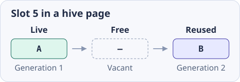

# Hive

`Hive<T, PAGE = 1024>` is an unordered container with stable addresses,
reusable slots and generational ids. Inserting returns an `Id`: a `u32` slot
index plus a generation. Removing an element frees its slot; the next element
there gets the next generation, so a stale id of a removed element never
matches a live one. Comparable in purpose to C++26 `std::hive`.

Python: `Hive`; ids are integers packed as `generation << 32 | index`.

<figure class="pc-figure">
  
  <figcaption>The original id for slot 5 and generation 1 is stale. Looking it up misses even after B occupies the same slot.</figcaption>
</figure>

## Example

<div class="lang-tabs">

```python
{{#include ../examples/hive.py}}
```

```rust
{{#include ../../../crates/paged-collections/examples/doc_hive.rs:2:}}
```

</div>

Python output:

```text
{{#include ../examples/hive.python.txt}}
```

The Rust example also prints `id_of index = 1`, the id recovered from the address of `hive[b]`.

## Guarantees

- **Stable addresses.** An element does not move while it is in the hive:
  inserts, removals of other elements, `reserve` and `shrink_to_fit` leave it
  in place. Only `sort` and its variants move elements.
- **Slot reuse.** Inserts fill one page with room at a time; within a page
  the last freed slot is reused first. A page with room is used before a new
  page is allocated, so memory follows the peak element count, not the number
  of inserts.
- **Iteration** is in slot order (page by page), not insertion order.
- **Memory return.** `shrink_to_fit` frees every empty page except pages
  holding a retired slot, scanning the slots of each empty page to check. A
  freed page keeps a record of its highest generation, so earlier ids stay
  dead when the page is reused.

## Finding and Sorting

- `id_of(&element)` returns the id of an element from its address, in
  O(pages).
- `sorted_ids()` (and `_by`, `_by_key`) returns live ids in element order and
  moves nothing.
- `sort()` (and `_by`, `_by_key`, `_by_cached_key`, `sort_unstable*`)
  reorders elements across the occupied slots, so iteration yields them
  sorted. Ids name slots: after `sort`, an id names whatever element moved
  into its slot.

## Complexity

| Operation | Cost |
|---|---|
| `insert`, `remove` | amortized O(1) |
| `get`, `contains`, `occupant` | O(1) |
| iteration | O(len) on full pages; skips empty pages, scans free slots in partial pages |
| `retain`, `clear`, `drain`, `extract_if` | O(pages + len) plus the scan |
| `reserve`, `shrink_to_fit` | O(pages) |
| `id_of` | O(pages) |

## Limits and Stale Ids

Slot indices are below `MAX_INDICES` (`u32::MAX`). Each slot issues at most
`MAX_GENERATION` (2<sup>31</sup>) ids; after that the slot is *retired* and
never reused, so generations never wrap. A page with a retired slot is never
freed. `is_exhausted` reports when no slot can be issued.

The stale-id guarantee holds within one history of one hive. Ids carry no
hive identity: another hive or a clone accepts them, and restoring an older
state (an older clone, an older serialized snapshot, an older pickle) revives
ids removed since.

## Side Tables

`Id` implements `Key` and `DirectKey`, so `PagedSparseMap<Id, V>` and
`PagedDirectMap<Id, V>` hold extra data per element. In Python use `IdMap`.
See [Ids and Side Tables](ids.md).

## Rust and Python

| Rust | Python |
|---|---|
| `insert(v) -> Id` | `insert(v) -> int`, `insert_many(values) -> ndarray[uint64]` |
| `get(id)`, `get_mut(id)`, indexing | `h[id]`, `get(id, default)`, `get_many(ids)` |
| `remove(id)` | `pop(id[, default])`, `del h[id]`, `discard(id)`, `discard_many(ids)` |
| `contains(id)` | `id in h`, `contains_many(ids)` |
| `ids()`, `values()`, `iter()` | `ids()`, `values()`, `items()`, `iter(h)` (ids) |
| `id_of(&v)` | |
| `sorted_ids*` | `sorted_ids(key=, reverse=)` |
| `sort*` | `sort(key=, reverse=)` |
| `retain`, `shrink_to_fit`, `reserve` | same names |

API: [`Hive`](https://docs.rs/paged-collections/latest/paged_collections/hive/struct.Hive.html).
