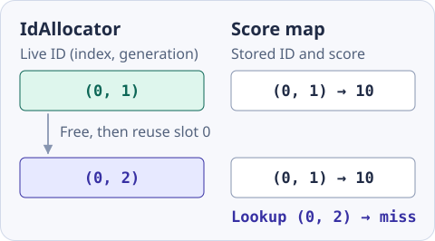

# Ids and Side Tables

## Keys and Slots

Every keyed collection stores at most one key per *slot*, and `Key::index`
names the slot. For integers the slot is the integer. For generational ids
(an index plus a generation counter) the slot is the index part, so all
generations of an id share one slot. A lookup with a generational id matches
only the generation stored in that collection.

What happens when an insert meets a slot held by another generation is
documented per method: `insert` evicts, `replace` evicts and returns,
`try_insert` refuses (see [Sparse Map](sparse-map.md#generational-keys)).

## IdAllocator

`IdAllocator` hands out `Id`s and recycles freed ones without storing values.
Freed indices are reused last freed first, with the next generation.
`index_bound()` is at most the peak number of live ids plus the retired
indices, which keeps the paged indices of the maps compact.

| Operation | Cost |
|---|---|
| `alloc`, `free` | amortized O(1) |
| `is_alive`, `occupant` | O(1) |
| `iter`, `retain`, `clear` | O(`index_bound`) |

Each index issues at most `MAX_GENERATION` (2<sup>31</sup>) ids, then retires.
The stale-id guarantee has the same scope as for the [hive](hive.md#limits-and-stale-ids):
one allocation history.

## Side Tables

Use the same id as a key in separate maps when each entity has several
associated values. The allocator and each map manage their own entries.

<figure class="pc-figure">
  
  <figcaption>The allocator increments the generation when it reuses a slot. Remove the old entry from each side table explicitly, or replace it when inserting the new generation.</figcaption>
</figure>

## Example

<div class="lang-tabs">

```python
{{#include ../examples/ids.py}}
```

```rust
{{#include ../../../crates/paged-collections/examples/doc_ids.rs:2:}}
```

</div>

Python output:

```text
{{#include ../examples/ids.python.txt}}
```

The Rust example prints the same lines.

## Custom Id Types

Implement `Key` (and `DirectKey` for direct maps) for your own id:

```rust
use paged_collections::key::Key;

/// Low 24 bits: index; high 8 bits: generation.
#[derive(Clone, Copy, PartialEq, Eq, Debug)]
struct Entity(u32);

impl Key for Entity {
    fn index(self) -> usize {
        (self.0 & 0x00ff_ffff) as usize
    }
}
```

`DirectKey` adds `type Tag` (the bits the index does not give, here the
generation), `tag(self)` and `from_parts(index, tag)`.

## Python Ids

Python ids are integers `generation << 32 | index`.

| Function | Result |
|---|---|
| `id_index(id)`, `id_generation(id)` | the parts |
| `make_id(index, generation)` | a packed id (generations 1 to 2**32 − 1) |
| `id_indices(ids)` | vectorized `id_index`, uint32 array |

`IdMap` and its typed variants (`IdMapF64`, ..., `id_map(dtype)`) are sparse
maps keyed by these ids. They accept ids from `IdAllocator` and `Hive`.
Their [ordered queries](sparse-map.md#rust-and-python) use slot indices and
return packed ids as keys.

| Rust | Python |
|---|---|
| `IdAllocator::alloc` | `alloc()`, `alloc_many(n)` |
| `free` | `free(id)`, `free_many(ids)` |
| `is_alive` | `is_alive(id)`, `id in a`, `is_alive_many(ids)` |
| `iter` | `iter(a)`, `ids()` |
| `index_bound`, `free_len`, `retired_len` | properties of the same names |

API: [`IdAllocator`](https://docs.rs/paged-collections/latest/paged_collections/id_alloc/struct.IdAllocator.html),
[`Key`](https://docs.rs/paged-collections/latest/paged_collections/key/trait.Key.html).
