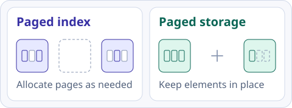

# Overview

`paged-collections` provides sparse sets, maps, a priority queue and
stable-address containers whose memory is split into fixed-size pages. The
core is a `no_std` Rust crate (`alloc` only); the Python package wraps it with
PyO3 and exchanges batches with NumPy.

<figure class="pc-figure pc-figure-wide">
  
</figure>

<nav class="pc-quicklinks" aria-label="Documentation links">
  <a href="installation.md">Installation &rarr;</a>
  <a href="choosing.md">Choosing a Container</a>
  <a href="paging.md">Paging Model</a>
</nav>

## Documentation

<div class="pc-guide-grid">
  <a class="pc-guide" href="sparse-set.md"><span class="pc-eyebrow">KEYED</span><strong>Sets, Maps, Priority Queue <span aria-hidden="true">&rarr;</span></strong><span>Integer or generational keys found through a paged index.</span></a>
  <a class="pc-guide" href="hive.md"><span class="pc-eyebrow">STORAGE</span><strong>Stable-Address Containers <span aria-hidden="true">&rarr;</span></strong><span>Vector, deque and hive whose elements never move as they grow.</span></a>
  <a class="pc-guide" href="concurrent.md"><span class="pc-eyebrow">THREADS</span><strong>Concurrent Containers <span aria-hidden="true">&rarr;</span></strong><span>Shared insertion and lookup; exclusive shrinking.</span></a>
  <a class="pc-guide" href="benchmarks.md"><span class="pc-eyebrow">MEASUREMENTS</span><strong>Benchmarks <span aria-hidden="true">&rarr;</span></strong><span>Reference timings and memory against standard containers.</span></a>
</div>

## Two Uses of Paging

- **Paged index.** A table indexed by key is split into pages allocated on
  first use. A write to an isolated key allocates only the page it touches.
  With the default `Flat` directory, the pointer table still grows up to the
  highest page number used. Sparse sets, sparse maps, direct maps and priority
  queues use a paged index.
- **Paged storage.** Growth adds pages while existing elements stay at their
  addresses. The paged vector, deque and hive use paged storage.

See [Paging Model](paging.md) for page sizes, directories and memory behaviour.

## Example

A `Hive` stores elements at stable addresses and returns generational ids. The
ids index the other maps directly, which makes side tables:

<div class="lang-tabs">

```python
{{#include ../examples/overview.py}}
```

```rust
{{#include ../../../crates/paged-collections/examples/doc_overview.rs:2:}}
```

</div>

Python output:

```text
{{#include ../examples/overview.python.txt}}
```

The Rust example prints `range = [30, 20]` in place of the last line: it queries the direct map by key range.

## Containers

| Rust | Python | Paging | Purpose |
|---|---|---|---|
| [`PagedSparseSet<K>`](sparse-set.md) | `SparseSet` | index | Integer set: O(1) insert, remove, contains and clear; dense iteration |
| [`PagedSparseMap<K, V>`](sparse-map.md) | `SparseMap`, `SparseMapF64`, ... | index | Sparse set with a dense value array |
| [`PagedDirectMap<K, V>`](direct-map.md) | `DirectMap`, `DirectMapF64`, ... | index | Values stored in place; key order and range queries |
| [`PagedPriorityQueue<K, P>`](priority-queue.md) | `PriorityQueue`, `PriorityQueueF64` | index | Indexed heap with priority changes and removal by key |
| [`ConcurrentPriorityQueue<K, P>`](concurrent.md#concurrentpriorityqueue) | `ConcurrentPriorityQueue`, `ConcurrentPriorityQueueF64` | index | Sharded max-priority queue; relaxed `pop`, exact `pop_exact` |
| [`PagedVec<T>`](paged-vec.md) | `PagedList`, `PagedListF64`, ... | storage | Growable vector with stable addresses |
| [`PagedDeque<T>`](deque.md) | `PagedDeque` | storage | Double-ended queue with stable addresses |
| [`ConcurrentQueue<T>`](concurrent.md#concurrentqueue) | `ConcurrentQueue` | storage | Shared FIFO queue; waits at page boundaries |
| [`Hive<T>`](hive.md) | `Hive` | storage | Unordered slots with generational ids |
| [`IdAllocator`](ids.md) | `IdAllocator`, `IdMap` | none | Generational id allocation for use as keys |

Thread-safe variants are listed under [Concurrent Containers](concurrent.md).
The full Rust API is on [docs.rs](https://docs.rs/paged-collections); the
Python API is typed in [`_core.pyi`](https://github.com/inspiros/paged-collections/blob/master/python/paged_collections/_core.pyi).
