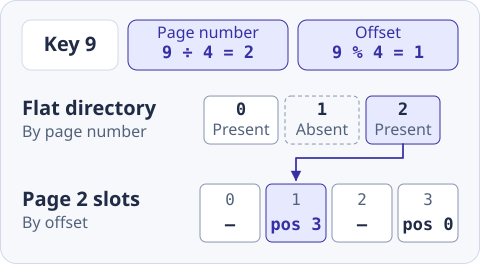
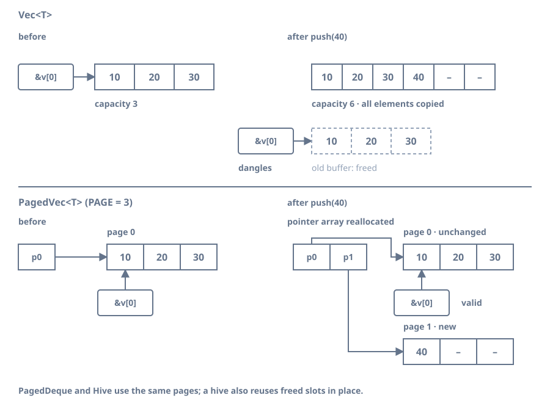

# Paging Model

<figure class="pc-hero">
  
</figure>

## Paged Index

Keyed collections map each key to a *slot index* (the integer itself, or the
index part of a generational id; see [Ids and Side Tables](ids.md)). The slot
index splits into a page number and an offset:

```text
page   = index / PAGE
offset = index % PAGE
```

A *directory* maps page numbers to pages. A page is a fixed array of `PAGE`
slots, allocated on the first write into it. Lookups into an unallocated page
return "absent" without allocating.

What a slot holds depends on the collection:

| Collection | Slot contents | Slot size |
|---|---|---|
| Sparse set, sparse map, priority queue | position in the dense array (`Option<NonZeroU32>`) | 4 bytes |
| Direct map | the value and the key's tag (`Option<(K::Tag, V)>`) | `size_of::<Option<(K::Tag, V)>>()`; 16 bytes for `u32 -> u64` |

With the default `PAGE = 1024`, a sparse-set page is 4 KiB and a
`u32 -> u64` direct-map page is 16 KiB.

## Directories

The directory is the last type parameter, for example
`PagedDirectMap<usize, u32, 1024, page::Radix>`.

| Marker | Structure | Page lookup | Directory memory |
|---|---|---|---|
| `page::Flat` (default) | `Vec<Option<Box<[T; PAGE]>>>` | O(1), one indirection | one pointer per page up to the highest page used |
| `page::Radix` | flat window for low page numbers, then a path-compressed 64-ary trie | O(1) in the window, else at most ceil(usize bits / 6) branches | proportional to the peak allocated page count |
| `page::Tree` | `BTreeMap<usize, Box<[T; PAGE]>>` | O(log pages) | proportional to allocated pages |

- **Flat** suits keys below a few billion, such as `u32` keys. Its directory
  holds at most `ceil(2^32 / PAGE)` pointers: 32 MiB at the default page
  size, plus up to as much again in `Vec` growth capacity until
  `shrink_to_fit`.
- **Radix** suits page numbers spread over the 64-bit range, where a flat
  directory cannot be allocated. Its flat window covers page numbers below
  about 8 times the allocated page count, so dense low keys cost the same as
  Flat. The window does not shrink below its highest live page.
- **Tree** is a standard B-tree; use it when measurements favour it for your
  key pattern.

Python classes always use `Flat`; their keys are below `2**32`.

## Page Size

`PAGE` is a const generic, default 1024. Larger pages mean fewer directory
entries and fewer allocations for dense keys, and more memory per isolated
key. Smaller pages waste less memory on sparse or clustered keys.
The page-size sweep in [Benchmarks](benchmarks.md#page-size) shows the trade
for each key pattern. In Python, pass `page_size=` (see
[Installation](installation.md#page-sizes)).

## Memory Behaviour

- **Each newly touched page costs a full page.** Keys spread uniformly over a
  wide range allocate and zero one page per key. This is the worst case for
  every paged-index collection; use a hash map for it.
- **Clustered keys fill pages partially.** Runs of 64 keys fill about 6% of a
  1024-slot page.
- **Pages are not freed when they empty.** `clear` keeps pages for reuse.
  `shrink_to_fit` frees empty pages (sparse set and map: all pages, only when
  empty), `reset` frees all pages. Removing a random 90% of keys frees
  almost nothing, because nearly every page stays partly occupied.
- **No automatic compaction.** Compaction would move elements and break the
  address and id guarantees.

## Paged Storage

<figure class="pc-hero">
  
</figure>

`PagedVec`, `PagedDeque` and `Hive` keep elements in pages of `PAGE` elements.
A page is allocated once and never reallocated. Growth appends a page and, at
most, grows the directory of page pointers, which is `PAGE` times shorter
than the element array. Consequences:

- An element keeps its address while it stays at its position (vector, deque)
  or in its slot (hive).
- Growth never copies elements; the worst-case push is one page allocation
  plus a directory copy.
- The elements are not one contiguous slice. Slices are available per page
  (`pages()` in Rust, `page_view()` for typed Python lists).

## Example

<div class="lang-tabs">

```python
{{#include ../examples/paging.py}}
```

```rust
{{#include ../../../crates/paged-collections/examples/doc_paging.rs:2:}}
```

</div>

Python output:

```text
{{#include ../examples/paging.python.txt}}
```

The Rust example prints the same lines.
