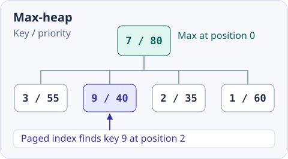

# Priority Queue

`PagedPriorityQueue<K, P, PAGE = 1024, D = Flat>` is an indexed max-heap: keys
map to priorities, the greatest priority comes out first, and a key's priority
can be changed or the key removed in O(log n). Use `core::cmp::Reverse` for a
min-queue. Keys and priorities live in parallel contiguous arrays in heap
order (a four-way heap); a paged index finds a key's heap position.

Python: `PriorityQueue` (int64 priorities) and `PriorityQueueF64` (float64);
`min=True` makes either a min-queue. Pushing a present key changes its
priority.

<figure class="pc-figure">
  
  <figcaption><code>pop</code> takes the root of the heap. Updating key 9 starts at position 2, and the entry moves if its new priority requires it.</figcaption>
</figure>

## Example

<div class="lang-tabs">

```python
{{#include ../examples/priority_queue.py}}
```

```rust
{{#include ../../../crates/paged-collections/examples/doc_priority_queue.rs:2:}}
```

</div>

Python output:

```text
{{#include ../examples/priority_queue.python.txt}}
```

The Rust example prints the first three lines.

## Complexity

| Operation | Cost |
|---|---|
| push, pop, change_priority, remove | O(log n) comparisons |
| peek, priority, contains_key | O(1) |
| `into_sorted_vec` | O(n log n) |

Equal priorities come out in unspecified order.

In Rust, `try_reserve(additional)` reserves room in both dense arrays.
If capacity overflows or allocation fails, the queue keeps its entries,
array addresses and capacity.

## Generational Keys

A slot holds one key. `push` evicts another generation of the key's slot;
`try_push` refuses. Lookups check the whole key.

## Panic Safety

If a priority comparison or a `change_priority_with` closure panics, every
remaining entry stays findable and paired with its priority, but heap order
may be broken: later `pop` and sorted results are unspecified. The same
applies when a stored priority's ordering changes through interior
mutability. Neither causes undefined behaviour.

## Rust and Python

| Rust | Python |
|---|---|
| `push(k, p) -> Option<P>` | `push(k, p)`, `q[k] = p` |
| `try_push` | |
| `push_increase`, `push_decrease` | `push_increase(k, p)`, `push_decrease(k, p)` |
| `pop()`, `peek()` | `pop()`, `peek()` (raise `IndexError` when empty) |
| `change_priority(&k, p)`, `change_priority_with` | `push(k, p)`, `q[k] = p` |
| `priority(&k)` | `q[k]`, `get(k, default)` |
| `remove(&k)` | `remove(k)`, `del q[k]` |
| `into_sorted_vec`, `into_sorted_iter` | `sorted()` |
| `keys`, `priorities`, `key_slice`, `priority_slice` | `keys()`, `items()` |
| `reserve`, `try_reserve` | |

Python `push_increase` and `push_decrease` insert an absent key or update its
priority only when the new numeric value is strictly greater or strictly
smaller, respectively. Both return whether the queue changed. With
`min=True`, `pop()` selects the lowest priority and these methods keep their
numeric meanings.

API: [`PagedPriorityQueue`](https://docs.rs/paged-collections/latest/paged_collections/priority_queue/struct.PagedPriorityQueue.html).
