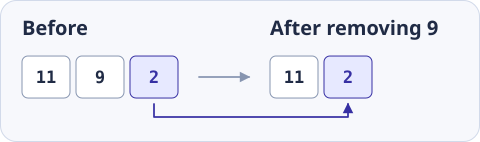

# Sparse Set

`PagedSparseSet<K, PAGE = 1024, D = Flat>` (Python: `SparseSet`) stores keys in
a contiguous *dense* array and finds them through a paged *sparse* index from
slot index to dense position.

## Example

<div class="lang-tabs">

```python
{{#include ../examples/sparse_set.py}}
```

```rust
{{#include ../../../crates/paged-collections/examples/doc_sparse_set.rs:2:}}
```

</div>

Python output:

```text
{{#include ../examples/sparse_set.python.txt}}
```

The Rust example prints the same lines without the set algebra.

## Complexity

| Operation | Cost |
|---|---|
| insert, remove, contains, get, take | O(1) with `Flat`; O(depth) with `Radix`; O(log pages) with `Tree` |
| clear | O(1): pages are kept, stale slots are ignored |
| iteration, `as_slice` | dense array only, O(len) |
| sort | O(n log n) comparisons, then one index write per key |

Lookups follow Briggs and Torczon. A lookup accepts a slot only if it points
inside the dense array to a key with the same slot index. This check lets
`clear` leave the index pages untouched.

## Order

Iteration follows the dense array in insertion order until a removal. `remove`
swaps the last key into the removed position (O(1)), changing the order.
`sort` and its variants reorder the dense array. Sorted order then lasts until
the next removal or insertion out of order.

<figure class="pc-figure">
  
  <figcaption>Swap removal updates the sparse index for the moved key. Iteration now yields 11, then 2.</figcaption>
</figure>

## Generational Keys

The set holds at most one key per slot index. With generational keys,
`insert` refuses a key whose slot is held by another generation and returns
`false`; `replace` evicts the other generation; `occupant(index)` returns the
key holding a slot. `get(key)` borrows the stored key and `take(key)`
removes and returns it. Both require an exact generation match.
See [Ids and Side Tables](ids.md).

## Rust and Python

| Rust | Python | Notes |
|---|---|---|
| `insert(k) -> bool` | `add(k)`, `add_many(keys) -> int` | |
| `remove(k) -> bool` | `discard(k)`, `remove(k)` (raises `KeyError`), `discard_many(keys)` | swap removal |
| `contains(k)` | `k in s`, `contains_many(keys) -> ndarray[bool]` | |
| `get(k)` | | borrows the stored key |
| `take(k)` | | returns the stored key by swap removal |
| `as_slice()` | `to_array()` (copy), `view()` (zero-copy, read-only) | |
| `iter()` | `iter(s)` | dense order |
| `first()`, `last()` | `first()`, `last()` | smallest and largest keys |
| `pop_first()`, `pop_last()` | `pop_first()`, `pop_last()` | remove and return the smallest and largest keys, respectively |
| `next_occupant`, `prev_occupant` | `next_occupant(index)`, `prev_occupant(index)` | nearest key at or after, or at or before, `index` |
| `sort*` | `sort()` | |
| `position(k)` | | dense position |
| `clear()` / `reset()` | `clear()` | `reset` frees pages |
| `allocated_pages()` | `allocated_pages` | |
| | `union`, `intersection`, `difference`, `symmetric_difference`, the `*_update` forms, `\| & - ^` and in-place operators, `issubset`, `issuperset`, `isdisjoint`, `< <= > >=` | Python set protocol |

Python keys are integers in `0 <= key < 2**32`. Batch lookups
(`contains_many`, `discard_many`) treat out-of-range integers as absent;
`add` and `add_many` raise for them.

Ordered queries use the sparse index, and `next_occupant` and `prev_occupant`
require a valid key and return `None` when no key matches. `first()`, `last()`,
`pop_first()` and `pop_last()` raise `KeyError` on an empty set. Ordered pops
use swap removal and raise `BufferError` while a `view()` is alive.

### Set Algebra

- Operators take `SparseSet` operands; methods accept any iterable of keys.
- Results use the receiver's page size, keep the receiver's surviving keys in
  order, then append new keys in operand iteration order.
- `difference_update` and `-=` use swap removal; other in-place operations
  keep the receiver's order.
- In-place operations raise `BufferError` while a `view()` is alive.

API: [`PagedSparseSet`](https://docs.rs/paged-collections/latest/paged_collections/sparse_set/struct.PagedSparseSet.html).
